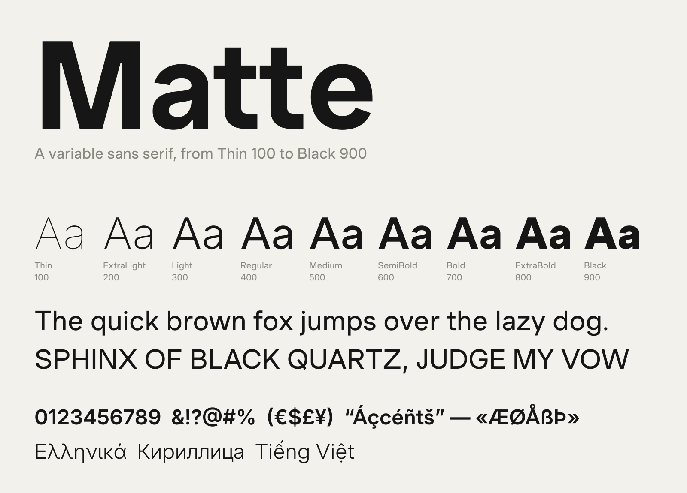

# Matte

Matte is a variable sans serif with one axis, weight, from Thin 100 to Black 900.



> **Early release (0.1xx).** Shapes, spacing and kerning may still change between versions.

## Download

Download `Matte-<version>.zip` from the latest [release](https://github.com/beamseree/matte/releases/latest). Inside:

| File | Use it for |
|---|---|
| `MatteVariable.ttf` | Installing on your computer: every weight in one file. On macOS, open it and click Install Font; on Windows, right-click it and choose Install. |
| `MatteVariable.woff2` | Websites: every weight in one file |
| `static/ttf/Matte-Thin.ttf` … `Matte-Black.ttf` | One file per weight, for apps that don't handle variable fonts well, such as some versions of Microsoft Office. Install the weights you need. |
| `static/web/Matte-Thin.woff2` … `Matte-Black.woff2` | One file per weight, for websites that only need one or two weights |

Install either the variable font or the separate weights, not both: they share their names, so apps can mix them up. The variable font and the webfont are also in this repo, in `fonts/`.

## Use it on the web

```css
@font-face {
  font-family: "Matte";
  src: url("MatteVariable.woff2") format("woff2");
  font-weight: 100 900;
  font-display: swap;
}

body {
  font-family: "Matte", sans-serif;
}
```

Any weight from 100 to 900 works, not only the named ones. The weights follow the usual scale, so 400 is a normal text Regular. Matte's Regular was drawn a little heavier, at 430: use `font-weight: 430` for the weight it was designed at.

## Weights and features

- Nine named weights: Thin 100, ExtraLight 200, Light 300, Regular 400, Medium 500, SemiBold 600, Bold 700, ExtraBold 800 and Black 900.
- Latin, including Vietnamese, plus Greek and Cyrillic: about 2,850 characters.
- Kerning, tabular figures (`tnum`), slashed zero (`zero`), fractions (`frac`), superiors and inferiors (`sups`, `subs`), case-sensitive punctuation (`case`), stylistic sets (`ss01`–`ss08`) and character variants (`cv01`–`cv16`).

## About

Matte is by [Beamseree](https://beamseree.com). It started from [Inter](https://github.com/rsms/inter) by Rasmus Andersson and the Inter Project Authors, and has been redrawn and respaced: straight-sided diagonals, flat-topped f and t, angled terminals on C, G, S and s, heavier joints where arches meet stems, a lower x-height and a heavier, lower-contrast Regular.

## License

Matte is licensed under the [SIL Open Font License 1.1](OFL.txt). You can use it freely in any project, personal or commercial, and modify and redistribute it, as long as the font itself isn't sold on its own and any modified version stays under this license.
